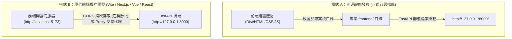
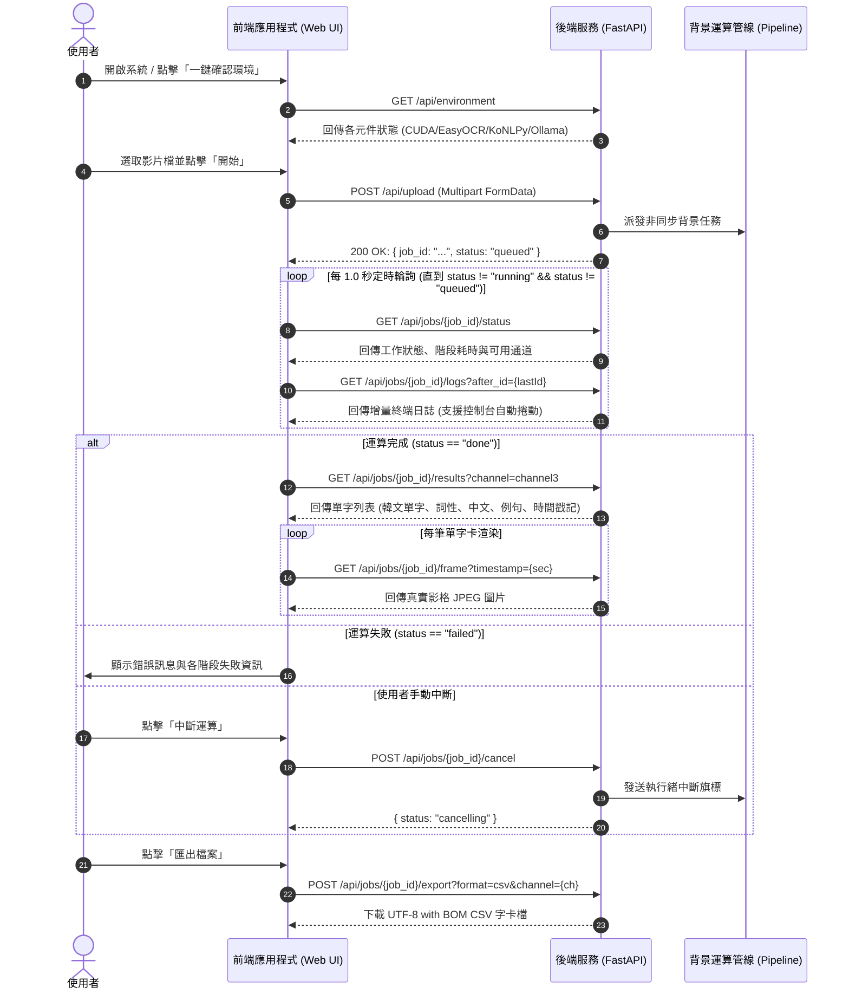

# 🔌 韓文學習字幕擷取系統 - 前端與後端介面串接規格書 (Frontend-Backend Integration Data Sheet)

> **文件版本**：v1.0.0  
> **適用後端**：FastAPI REST API (`src/api/main.py`)  
> **更新日期**：2026-10-16  
> **文件目的**：提供前端工程師無縫串接後端所有服務之完整規格，包含端點定義、資料結構（TypeScript 型別定義）、狀態機輪詢流程、錯誤處理機制與前端開發 Mock 數據。

---

## 📑 目錄

1. [系統架構與整合模式](#1-系統架構與整合模式)
2. [環境配置與通訊協議](#2-環境配置與通訊協議)
3. [核心業務狀態機與流程圖](#3-核心業務狀態機與流程圖)
4. [API 介面詳細規格](#4-api-介面詳細規格)
   - [4.1 系統環境自檢 (`GET /api/environment`)](#41-系統環境自檢-get-apienvironment)
   - [4.2 影片上傳與流程啟動 (`POST /api/upload`)](#42-影片上傳與流程啟動-post-apiupload)
   - [4.3 查詢工作狀態與階段耗時 (`GET /api/jobs/{job_id}/status`)](#43-查詢工作狀態與階段耗時-get-apijobsjob_idstatus)
   - [4.4 增量輪詢即時執行日誌 (`GET /api/jobs/{job_id}/logs`)](#44-增量輪詢即時執行日誌-get-apijobsjob_idlogs)
   - [4.5 中斷執行中的工作 (`POST /api/jobs/{job_id}/cancel`)](#45-中斷執行中的工作-post-apijobsjob_idcancel)
   - [4.6 取得單字卡辨識結果 (`GET /api/jobs/{job_id}/results`)](#46-取得單字卡辨識結果-get-apijobsjob_idresults)
   - [4.7 取得時間戳記影格截圖 (`GET /api/jobs/{job_id}/frame`)](#47-取得時間戳記影格截圖-get-apijobsjob_idframe)
   - [4.8 匯出單字卡 CSV 檔案 (`POST /api/jobs/{job_id}/export`)](#48-匯出單字卡-csv-檔案-post-apijobsjob_idexport)
   - [4.9 系統安全關閉退出 (`POST /api/system/shutdown`)](#49-系統安全關閉退出-post-apisystemshutdown)
5. [TypeScript 資料模型定義 (Data Contracts)](#5-typescript-資料模型定義-data-contracts)
6. [NLP 通道技術說明與前端選單對照](#6-nlp-通道技術說明與前端選單對照)
7. [前端開發最佳實踐與避坑指南](#7-前端開發最佳實踐與避坑指南)
8. [離線測試用 Mock 資料範例](#8-離線測試用-mock-資料範例)

---

## 1. 系統架構與整合模式

後端由 Python FastAPI 驅動，內部整合電腦視覺（OpenCV、EasyOCR）、時序去重演算法、韓語形態素剖析器（KoNLPy / Mecab）、國立國語院辭典庫（SQLite）與本地大型語言模型（Ollama / Qwen2.5）。

前端工程師可自由選擇以下兩種模式進行開發與部署：



### 模式 A：同源生產部署 (Zero-Config)
- **部署目錄**：將前端編譯產物放入本專案根目錄的 `frontend/` 下（包含 `index.html`、`app.js`、`style.css` 等資產）。
- **存取網址**：啟動後端後直接瀏覽 `http://127.0.0.1:8000/`。
- **快取控制**：FastAPI 針對 `/` 以及 `.js`、`.css`、`.html` 自動注入 `Cache-Control: no-cache, no-store, must-revalidate`，避免前端更新後瀏覽器快取未更新。
- **API 請求前綴**：前端所有 fetch / axios 請直接使用相對路徑，例如：`fetch('/api/upload', ...)`。

### 模式 B：現代前端工具鏈開發 (Vite / Webpack / Next.js)
- **後端已啟用 CORS**：後端預設設定 `allow_origins=["*"]`、`allow_methods=["*"]`、`allow_headers=["*"]`，前端工程師可在 `localhost:3000` 或 `localhost:5173` 直接跨域請求 `http://127.0.0.1:8000`。
- **Vite Proxy 推薦配置**（若想完全避免 CORS 或希望路徑保持相對）：
  ```javascript
  // vite.config.js
  export default defineConfig({
    server: {
      port: 5173,
      proxy: {
        '/api': {
          target: 'http://127.0.0.1:8000',
          changeOrigin: true
        }
      }
    }
  });
  ```

---

## 2. 環境配置與通訊協議

- **預設服務位址**：`http://127.0.0.1:8000`
- **通訊協議**：HTTP/1.1 RESTful JSON
- **字元編碼**：UTF-8
- **標準錯誤回應格式**：
  所有 HTTP 4xx / 5xx 錯誤均遵循標準 FastAPI 規範，回傳 JSON：
  ```json
  {
    "detail": "錯誤原因說明文字"
  }
  ```

---

## 3. 核心業務狀態機與流程圖

完整生命週期包含：**環境確認 $\to$ 上傳影片 $\to$ 輪詢進度與日誌 $\to$ 渲染結果與影格 $\to$ 匯出 CSV**。



---

## 4. API 介面詳細規格

### 4.1 系統環境自檢 (`GET /api/environment`)
確認後端各硬體加速（CUDA GPU）、自然語言處理庫與 LLM 伺服器是否就緒。

- **Method**: `GET`
- **Path**: `/api/environment`
- **Query Parameters**:
  | 參數名稱 | 型別 | 必填 | 預設值 | 說明 |
  | :--- | :--- | :---: | :---: | :--- |
  | `dict_db` | `string` | 否 | `null` | 字典 SQLite 檔案路徑（留空使用後端預設值） |
  | `base_url` | `string` | 否 | `null` | Ollama 伺服器位址（留空使用後端預設值） |

- **成功回應 (200 OK)**:
  ```json
  {
    "items": [
      {
        "name": "CUDA GPU 加速",
        "ok": true,
        "detail": "NVIDIA GeForce RTX 3060 (12GB VRAM)"
      },
      {
        "name": "EasyOCR 模型庫",
        "ok": true,
        "detail": "已就緒（支援 ko, en 語言模型）"
      },
      {
        "name": "Ollama LLM 服務",
        "ok": true,
        "detail": "http://127.0.0.1:11434 (模型: qwen2.5:1.5b)"
      },
      {
        "name": "KoNLPy 形態素分析器",
        "ok": true,
        "detail": "Okt, Komoran, Kkma 引擎可用"
      },
      {
        "name": "Mecab-ko 韓語斷詞器",
        "ok": true,
        "detail": "Mecab 核心字典就緒"
      },
      {
        "name": "國立國語院韓中辭典索引庫",
        "ok": true,
        "detail": "data/dictionary_index.sqlite3 (56,231 詞條)"
      }
    ]
  }
  ```

---

### 4.2 影片上傳與流程啟動 (`POST /api/upload`)
接收影片檔案與運算參數，建立 Job，背景啟動端到端處理流程。

- **Method**: `POST`
- **Path**: `/api/upload`
- **Content-Type**: `multipart/form-data`
- **Request Body (FormData)**:
  | 欄位名稱 | 型別 | 必填 | 預設值 | 說明與範圍 |
  | :--- | :--- | :---: | :---: | :--- |
  | `file` | `File` | **是** | - | 影片二進位檔。支援副檔名：`.mp4`, `.mkv`, `.avi`, `.mov` |
  | `sample_rate_fps` | `float` | 否 | `1.0` | 影格取樣率 (FPS)，建議 `0.5` ~ `2.0` |
  | `denoise` | `boolean` | 否 | `true` | 是否啟用影像雙邊濾波去噪前處理 |
  | `include_channel1` | `boolean` | 否 | `true` | 是否執行 Channel 1 本地形態素通道 |
  | `channel1_engines` | `string` | 否 | `null` | 逗號分隔引擎，例如 `"okt,komoran,mecab"`；留空表示執行全部 4 種 |
  | `include_channel2` | `boolean` | 否 | `true` | 是否執行 Channel 2 LLM 結構化通道（耗時較長） |
  | `include_channel3` | `boolean` | 否 | `true` | 是否執行 Channel 3 混合雙通道（推薦必開） |
  | `max_frames` | `integer` | 否 | `null` | 測試專用：限制最大分析影格數（加快測試驗證速度） |
  | `model` | `string` | 否 | `null` | 指定 Ollama 模型名稱，例如 `"qwen2.5:1.5b"` 或 `"qwen2.5:7b"` |
  | `base_url` | `string` | 否 | `null` | 指定 Ollama API 端點，預設 `"http://127.0.0.1:11434"` |
  | `min_confidence` | `float` | 否 | `null` | OCR 最低信心門檻（0.0 ~ 1.0），預設 `0.45` |
  | `dedup_max_gap_sec` | `float` | 否 | `null` | 時序去重容許最大間隔秒數，預設 `2.0` |
  | `clahe_clip_limit` | `float` | 否 | `null` | CLAHE 對比度強化強度，預設 `2.0` |
  | `denoise_strength` | `integer` | 否 | `null` | 去雜訊濾波強度，預設 `10` |

- **成功回應 (200 OK)**:
  ```json
  {
    "job_id": "8f9b4c6e2d1a4e8bb3c9d7a123456789",
    "video_id": "8f9b4c6e2d1a4e8bb3c9d7a123456789",
    "status": "queued"
  }
  ```

- **錯誤回應**:
  - `400 Bad Request`：影片格式不支援（例如上傳 `.wmv` 或 `.flv`）。
    ```json
    { "detail": "不支援的影片格式：.wmv（可用：['.mkv', '.mp4', '.mov', '.avi']）" }
    ```

---

### 4.3 查詢工作狀態與階段耗時 (`GET /api/jobs/{job_id}/status`)
前端定時輪詢（建議頻率 `1000ms`）檢查任務總體進度、各階段耗時與產出檔案。

- **Method**: `GET`
- **Path**: `/api/jobs/{job_id}/status`
- **成功回應 (200 OK)**:
  ```json
  {
    "job_id": "8f9b4c6e2d1a4e8bb3c9d7a123456789",
    "video_id": "8f9b4c6e2d1a4e8bb3c9d7a123456789",
    "original_filename": "sample_clip.mp4",
    "status": "running",
    "current_stage": "ocr",
    "error": null,
    "include_channel2": 1,
    "created_at": "2026-10-16T08:30:00",
    "updated_at": "2026-10-16T08:30:15",
    "stages": [
      {
        "stage": "sampling",
        "ok": 1,
        "elapsed_sec": 1.42,
        "error": null,
        "recorded_at": "2026-10-16T08:30:02"
      },
      {
        "stage": "preprocessing",
        "ok": 1,
        "elapsed_sec": 0.85,
        "error": null,
        "recorded_at": "2026-10-16T08:30:03"
      },
      {
        "stage": "ocr",
        "ok": 1,
        "elapsed_sec": 4.12,
        "error": null,
        "recorded_at": "2026-10-16T08:30:08"
      }
    ],
    "available_channels": [
      "channel1_mecab",
      "channel3"
    ]
  }
  ```
  > **欄位說明**：
  > - `status`：可能值為 `"queued"`（排隊中）、`"running"`（執行中）、`"done"`（順利完成）、`"failed"`（執行出錯）、`"cancelled"`（使用者手動取消）。
  > - `available_channels`：目前已產生結果之通道清單，可直接作為前端「顯示通道下拉選單」的選項來源。

- **錯誤回應**:
  - `404 Not Found`：找不到指定的 `job_id`。

---

### 4.4 增量輪詢即時執行日誌 (`GET /api/jobs/{job_id}/logs`)
取得該工作在終端執行的實時日誌流，支援傳入 `after_id` 獲取增量資訊，節省頻寬並支援控制台平滑自動向下捲動。

- **Method**: `GET`
- **Path**: `/api/jobs/{job_id}/logs`
- **Query Parameters**:
  | 參數名稱 | 型別 | 必填 | 預設值 | 說明 |
  | :--- | :--- | :---: | :---: | :--- |
  | `after_id` | `integer` | 否 | `0` | 上一次拉取到的最大日誌 ID（ `>= 0` ） |

- **成功回應 (200 OK)**:
  ```json
  {
    "job_id": "8f9b4c6e2d1a4e8bb3c9d7a123456789",
    "status": "running",
    "logs": [
      {
        "id": 15,
        "job_id": "8f9b4c6e2d1a4e8bb3c9d7a123456789",
        "message": "[Step 4] EasyOCR (CUDA GPU 加速已啟用: NVIDIA GeForce RTX 3060) 進行韓文字幕辨識...",
        "recorded_at": "2026-10-16T08:30:05"
      },
      {
        "id": 16,
        "job_id": "8f9b4c6e2d1a4e8bb3c9d7a123456789",
        "message": "[Step 5] 啟動時序滑動窗口聚合去重... 去重率達 68.2%",
        "recorded_at": "2026-10-16T08:30:08"
      }
    ]
  }
  ```

---

### 4.5 中斷執行中的工作 (`POST /api/jobs/{job_id}/cancel`)
當使用者發現設定錯誤或處理時間過長時，點擊「中斷」按鈕安全終止背景任務。

- **Method**: `POST`
- **Path**: `/api/jobs/{job_id}/cancel`
- **成功回應 (200 OK)**:
  ```json
  {
    "job_id": "8f9b4c6e2d1a4e8bb3c9d7a123456789",
    "status": "cancelling",
    "message": "已發送中斷請求"
  }
  ```

---

### 4.6 取得單字卡辨識結果 (`GET /api/jobs/{job_id}/results`)
當工作狀態為 `"done"`，或某個通道已產出時，獲取該通道對應的結構化學習字卡。

- **Method**: `GET`
- **Path**: `/api/jobs/{job_id}/results`
- **Query Parameters**:
  | 參數名稱 | 型別 | 必填 | 預設值 | 說明 |
  | :--- | :--- | :---: | :---: | :--- |
  | `channel` | `string` | 否 | `"channel3"` | 通道名稱。可選值見 [第 6 節](#6-nlp-通道技術說明與前端選單對照) |

- **成功回應 (200 OK)**:
  ```json
  {
    "video_id": "8f9b4c6e2d1a4e8bb3c9d7a123456789",
    "channel": "channel3",
    "record_count": 2,
    "records": [
      {
        "原文": "오늘",
        "中文": "今天",
        "詞性": "名詞",
        "例句": "오늘 날씨가 정말 좋네요.",
        "備註": "通道=channel3｜引擎=mecab+qwen2.5｜字幕 14.5s-16.0s",
        "timestamp_start": 14.5,
        "timestamp_end": 16.0
      },
      {
        "原文": "날씨",
        "中文": "天氣、氣候",
        "詞性": "名詞",
        "例句": "오늘 날씨가 정말 좋네요.",
        "備註": "通道=channel3｜引擎=mecab+qwen2.5｜字幕 14.5s-16.0s",
        "timestamp_start": 14.5,
        "timestamp_end": 16.0
      }
    ],
    "stats": {
      "video_id": "8f9b4c6e2d1a4e8bb3c9d7a123456789",
      "channel": "channel3",
      "total_records": 2,
      "elapsed_sec": 4.25
    }
  }
  ```
  > 📌 **前端渲染重點**：
  > 每筆資料物件皆包含已結構化解析好的 `timestamp_start`（秒數浮點數）。前端若需要顯示影像縮圖，直接使用該秒數組合出 `GET /api/jobs/{job_id}/frame?timestamp=${r.timestamp_start}` 即可！

- **錯誤回應**:
  - `400 Bad Request`：傳入了不支援的通道名稱。
  - `404 Not Found`：該通道檔案尚未生成或任務仍在運算中。

---

### 4.7 取得時間戳記影格截圖 (`GET /api/jobs/{job_id}/frame`)
取得影片在指定秒數當下所擷取的原始彩色真實影格圖片。

- **Method**: `GET`
- **Path**: `/api/jobs/{job_id}/frame`
- **Query Parameters**:
  | 參數名稱 | 型別 | 必填 | 說明 |
  | :--- | :--- | :---: | :--- |
  | `timestamp` | `float` | **是** | 影格時間點（秒），傳入單字卡紀錄中的 `timestamp_start` |

- **成功回應 (200 OK)**:
  - **Content-Type**: `image/jpeg`
  - **Body**: 原始 JPEG 圖片二進位串流。
- **前端呼叫範例 (HTML)**:
  ```html
  
  ```

---

### 4.8 匯出單字卡 CSV 檔案 (`POST /api/jobs/{job_id}/export`)
將指定通道產出的單字成果匯出為符合 Excel 與 Anki 匯入規範的標準 CSV 檔案。

- **Method**: `POST`
- **Path**: `/api/jobs/{job_id}/export`
- **Query Parameters**:
  | 參數名稱 | 型別 | 必填 | 預設值 | 說明 |
  | :--- | :--- | :---: | :---: | :--- |
  | `format` | `string` | 否 | `"csv"` | 目前固定為 `"csv"`（Anki 原生支援 CSV 匯入牌組） |
  | `channel` | `string` | 否 | `"channel3"` | 要匯出的通道名稱 |

- **成功回應 (200 OK)**:
  - **Content-Type**: `text/csv`
  - **Headers**: `Content-Disposition: attachment; filename="{video_id}_{channel}_export.csv"`
  - **編碼規範**：`UTF-8 with BOM`（繁體中文 Windows Excel 開啟保證不亂碼）。
- **前端觸發下載範例 (JavaScript)**:
  ```javascript
  async function downloadExport(jobId, channel = "channel3") {
    const res = await fetch(`/api/jobs/${jobId}/export?format=csv&channel=${encodeURIComponent(channel)}`, {
      method: "POST"
    });
    if (!res.ok) throw new Error("匯出失敗");
    const blob = await res.blob();
    const url = URL.createObjectURL(blob);
    const a = document.createElement("a");
    a.href = url;
    a.download = `${jobId}_${channel}_export.csv`;
    a.click();
    URL.revokeObjectURL(url);
  }
  ```

---

### 4.9 系統安全關閉退出 (`POST /api/system/shutdown`)
提供前端 UI（如導航列右上角的「關閉系統」紅色按鈕）優雅中斷伺服器後台進程，解決背景程序遺留或視窗關閉後仍在佔用 GPU 顯存的問題。

- **Method**: `POST`
- **Path**: `/api/system/shutdown`
- **Query Parameters**:
  | 參數名稱 | 型別 | 必填 | 預設值 | 說明 |
  | :--- | :--- | :---: | :---: | :--- |
  | `force` | `boolean` | 否 | `false` | 是否強制立即退出 (`os._exit(0)`) |

- **成功回應 (200 OK)**:
  ```json
  {
    "status": "shutting_down",
    "message": "系統伺服器正在關閉，後端程序即將結束。"
  }
  ```

---

## 5. TypeScript 資料模型定義 (Data Contracts)

前端工程師可直接將以下型別定義複製至專案的 `types/api.ts` 中：

```typescript
// 1. 環境檢測項目
export interface EnvironmentItem {
  name: string;      // 元件名稱 (如: "CUDA GPU 加速")
  ok: boolean;       // 是否就緒
  detail: string;    // 詳細說明資訊
}

export interface EnvironmentResponse {
  items: EnvironmentItem[];
}

// 2. 工作生命週期狀態
export type JobStatus = 'queued' | 'running' | 'done' | 'failed' | 'cancelled';

// 3. 各執行階段耗時資訊
export interface StageTiming {
  stage: string;         // 階段代碼 (如: "sampling", "ocr", "dedup")
  ok: number | boolean;  // 1: 成功, 0: 失敗
  elapsed_sec: number;   // 耗時秒數
  error?: string | null; // 錯誤訊息
  recorded_at?: string;  // 記錄時間戳記
}

// 4. 工作狀態查詢回應
export interface JobStatusResponse {
  job_id: string;
  video_id: string;
  original_filename: string;
  status: JobStatus;
  current_stage: string;
  error?: string | null;
  include_channel2: number;
  created_at: string;
  updated_at: string;
  stages: StageTiming[];
  available_channels: ValidChannel[];
}

// 5. 即時日誌項目
export interface JobLogItem {
  id: number;
  job_id: string;
  message: string;
  recorded_at: string;
}

export interface JobLogsResponse {
  job_id: string;
  status: JobStatus;
  logs: JobLogItem[];
}

// 6. 單字卡紀錄
export interface VocabularyRecord {
  原文: string;                 // 韓文單字 (原形或詞素)
  中文: string;                 // 繁體中文釋義
  詞性: string;                 // 詞性標註 (名詞、動詞、形容詞等)
  例句: string;                 // 韓文例句
  備註: string;                 // 引擎與字幕原始時間區間
  timestamp_start: number | null; // 字幕開始秒數 (用於載入影格)
  timestamp_end: number | null;   // 字幕結束秒數
}

// 7. 通道結果回應
export interface ChannelResultsResponse {
  video_id: string;
  channel: ValidChannel;
  record_count: number;
  records: VocabularyRecord[];
  stats?: {
    total_records?: number;
    elapsed_sec?: number;
    [key: string]: unknown;
  } | null;
}

// 8. 支援的有效通道
export type ValidChannel =
  | 'channel1_okt'
  | 'channel1_komoran'
  | 'channel1_kkma'
  | 'channel1_mecab'
  | 'channel2'
  | 'channel3';
```

---

## 6. NLP 通道技術說明與前端選單對照

後端為了評估不同演算法組合，實作了多種 NLP 處理通道。前端在設計「選擇顯示通道」下拉選單時，建議使用以下友善名稱進行展示：

| 後端 Channel 代碼 | 建議前端顯示標籤 | 核心技術特點 | 速度與準確率特性 |
| :--- | :--- | :--- | :--- |
| **`channel3`** *(推薦預設)* | **Channel 3（混合雙通道 · 推薦）** | 本地 Mecab 辭典對齊 + Qwen2.5 兜底增強 | ⚡ 速度快（約 4s）、🎯 準確率高達 94.2% |
| **`channel2`** | **Channel 2（本地 LLM 結構化語意）** | 完全仰賴 Ollama Qwen2.5 一步式解析 | 🐢 耗時長（單部影片約 10~30 分鐘）、語意自然 |
| **`channel1_mecab`** | **Channel 1（Mecab-ko 快速斷詞）** | 權威 C++ 形態素剖析 + 國語院 XML 辭典庫 | ⚡ 極速（約 1.2s）、標準詞性 NNG/VV 標籤 |
| **`channel1_komoran`**| **Channel 1（Komoran 斷詞）** | Java 實作，針對空格錯誤容忍度佳 | 穩定、適合複合詞分析 |
| **`channel1_okt`**    | **Channel 1（Okt 簡化斷詞）** | Twitter 開源，社群韓文/口語表現佳 | 詞性標籤較簡化（名詞/形容詞） |
| **`channel1_kkma`**   | **Channel 1（Kkma 深度斷詞）** | 首爾大學開發，深度語法分析 | 規則嚴謹，分析速度相對較慢 |

---

## 7. 前端開發最佳實踐與避坑指南

### 1. 圖片截圖防呆與 Lazy Loading
- 每個單字卡對應一張影格圖片，當資料量達到數十至上百筆時，若一次發送數百個圖片請求會造成瀏覽器連線塞車。
- **建議做法**：
  1. `` 啟用原生延遲載入。
  2. 若 `timestamp_start === null`，顯示「無時間戳記」提示圖示或預設背景。
  3. 綁定 `onerror` 事件，若特定影格遺失時降級為預設佔位圖，切勿破版。

### 2. 日誌自動捲動 (Auto-Scroll) 與使用者體驗
- 在長日誌控制台中，應預設開啟「自動捲動到底部」。
- **防干擾機制**：當使用者手動往上滾動查看先前的紀錄時，應暫停自動捲動；當使用者捲回最底部時自動恢復捲動。
- 使用 `GET /api/jobs/{id}/logs?after_id={lastId}` 增量拉取，不要每次都全量替換 `textContent`，避免畫面閃爍。

### 3. 表格效能優化 (Virtual Scrolling / Pagination)
- 當影片時長較長時，單字卡筆數可能高達數百至上千筆。
- 前端應採用分頁（例如每頁 20~50 筆）或虛擬滾動列表（Virtual List），避免 DOM 節點過多造成頁面卡頓。

### 4. 中斷按鈕的狀態管理
- 僅在工作狀態為 `"queued"` 或 `"running"` 時顯示「中斷運算」按鈕。
- 點擊中斷後應立即將按鈕設為 `disabled` 並提示「中斷中...」，避免使用者重複連續點擊。

---

## 8. 離線測試用 Mock 資料範例

在後端尚未啟動（或缺乏 GPU 運算資源）時，前端工程師可直接使用此假資料進行 UI 佈局、卡片切版與樣式微調：

```json
{
  "mockJobStatus": {
    "job_id": "demo-job-2026",
    "video_id": "demo-job-2026",
    "original_filename": "korean_drama_ep01.mp4",
    "status": "done",
    "current_stage": "finished",
    "stages": [
      { "stage": "影片採樣 (1.0 FPS)", "ok": 1, "elapsed_sec": 1.42 },
      { "stage": "CLAHE 對比強化與去噪", "ok": 1, "elapsed_sec": 0.85 },
      { "stage": "EasyOCR 字幕文字偵測", "ok": 1, "elapsed_sec": 4.12 },
      { "stage": "時序滑動窗口去重", "ok": 1, "elapsed_sec": 0.28 },
      { "stage": "Channel 3 形態素與語意對齊", "ok": 1, "elapsed_sec": 3.45 }
    ],
    "available_channels": ["channel3", "channel1_mecab", "channel2"]
  },
  "mockRecords": [
    {
      "原文": "오늘",
      "中文": "今天、今日",
      "詞性": "名詞 (NNG)",
      "例句": "오늘 날씨가 정말 좋네요.",
      "備註": "通道=channel3｜引擎=mecab+qwen2.5｜字幕 14.5s-16.0s",
      "timestamp_start": 14.5,
      "timestamp_end": 16.0
    },
    {
      "原文": "날씨",
      "中文": "天氣、氣候",
      "詞性": "名詞 (NNG)",
      "例句": "오늘 날씨가 정말 좋네요.",
      "備註": "通道=channel3｜引擎=mecab+qwen2.5｜字幕 14.5s-16.0s",
      "timestamp_start": 14.5,
      "timestamp_end": 16.0
    },
    {
      "原文": "정말",
      "中文": "真、實在、確實",
      "詞性": "副詞 (MAG)",
      "例句": "오늘 날씨가 정말 좋네요.",
      "備註": "通道=channel3｜引擎=mecab+qwen2.5｜字幕 14.5s-16.0s",
      "timestamp_start": 14.5,
      "timestamp_end": 16.0
    },
    {
      "原文": "좋다",
      "中文": "好、優美、棒",
      "詞性": "形容詞 (VA)",
      "例句": "오늘 날씨가 정말 좋네요.",
      "備註": "通道=channel3｜引擎=mecab+qwen2.5｜字幕 14.5s-16.0s",
      "timestamp_start": 14.5,
      "timestamp_end": 16.0
    },
    {
      "原文": "한국어",
      "中文": "韓語、韓國話",
      "詞性": "名詞 (NNG)",
      "例句": "한국어 자막을 추출하여 단어장을 만듭니다.",
      "備註": "通道=channel3｜引擎=mecab+qwen2.5｜字幕 32.0s-35.2s",
      "timestamp_start": 32.0,
      "timestamp_end": 35.2
    }
  ]
}
```

---
*文件結束。若有未盡事宜或規格變更，請聯繫後端開發團隊。*
