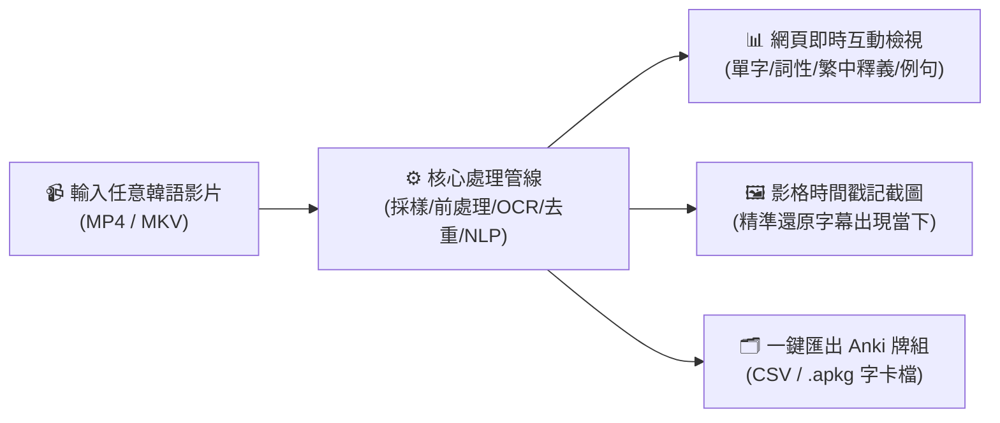
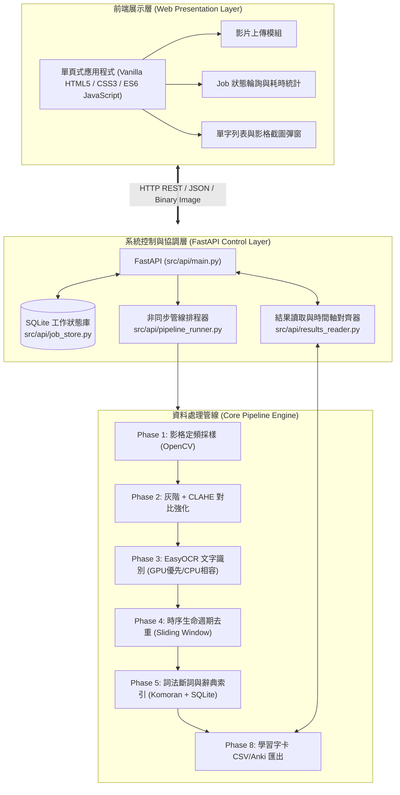
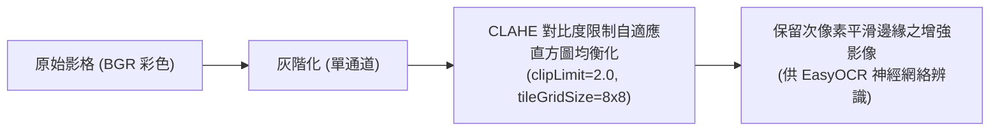
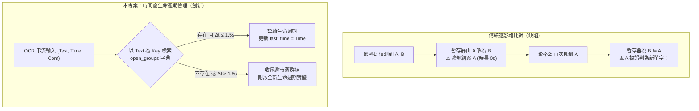
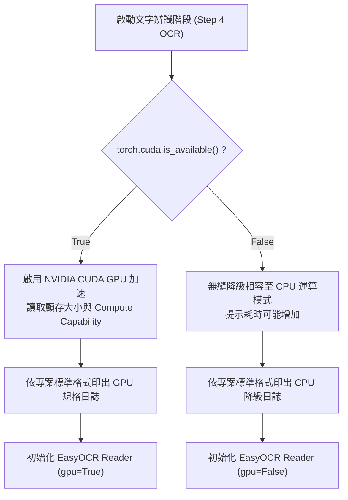

# 🎬 韓文學習字幕擷取系統 (Korean Video Subtitle OCR & Lexicon Pipeline)

[](https://www.python.org/)
[](https://fastapi.tiangolo.com/)
[](https://github.com/JaidedAI/EasyOCR)
[]()
[]()

> 一款專為韓文自學者與語言研究者設計之**全自動化影片字幕擷取、語意解析與單字學習卡生成系統**。  
> 僅需輸入任意韓語教學、戲劇或生活影片，系統即自動完成「影格定頻採樣 $\to$ 影像對比強化 $\to$ OCR 文字辨識 $\to$ 時序去重聚合 $\to$ 多通道詞法斷詞與權威辭典對齊 $\to$ 產生具備時間戳記與截圖對照之 Anki 學習字卡」。

---

## 📑 目錄
- [一、 專案功能性說明](#一-專案功能性說明)
- [二、 從無到有專案部署操作指引（初學者友善）](#二-從無到有專案部署操作指引初學者友善)
- [三、 專案技術框架與範疇說明](#三-專案技術框架與範疇說明)
- [四、 系統內部核心技術細節解析](#四-系統內部核心技術細節解析)
- [五、 核心技術推導結論（千字數據決策分析）](#五-核心技術推導結論千字數據決策分析)

---

## 一、 專案功能性說明

本專案旨在解決傳統人工觀看韓語教學影片手抄單字費時費力的痛點，透過現代電腦視覺（CV）與計算語言學（NLP）技術實現全流程自動化：



### 核心功能矩陣
1. **多格式影片匯入**：支援常見主流格式（MP4、MKV、AVI、MOV 等），支援拖曳上傳與自動中繼資料提取。
2. **高容錯影像增強**：針對複雜或多變之字幕背景，採用灰階自適應直方圖均衡化（CLAHE），保留文字微細特徵。
3. **時序感知智慧去重**：獨家「滑動時間窗生命週期」演算法，根除字幕停留時產生的碎片化垃圾字卡。
4. **權威韓中辭典對齊**：內建國立國語院 5.6 萬詞條（7.6 萬詞義）LMF-XML 辭典庫，精準提供中文翻譯、詞性標註與實用例句。
5. **硬體動態相容調度**：優先啟動 NVIDIA CUDA GPU 加速運算；若無獨立顯卡則自動無縫降級為 CPU 相容模式，絕不閃退。
6. **即時監控 Web SPA 介面**：提供即時進度輪詢、各階段耗時分析、環境健檢面板與視覺化單字對照表格。

---

## 二、 從無到有專案部署操作指引（初學者友善）

本指南專為**一般使用者或電腦初學者**撰寫，提供最直觀、步驟化的「貼上即執行」部署體驗。

### 步驟 1：基礎環境安裝（僅需安裝一次）
若您的電腦尚未安裝 Python 與 Java，請在 Windows 搜尋欄輸入 `powershell`，在 **Windows PowerShell** 上按滑鼠右鍵選擇 **「以系統管理員身分執行」**，接著直接複製貼上以下指令並按 Enter：

```powershell
# 使用 Windows 內建套件管理員一鍵安裝 Python 3.11 與 OpenJDK 17
winget install Python.Python.3.11 --silent --accept-package-agreements --accept-source-agreements
winget install Microsoft.OpenJDK.17 --silent --accept-package-agreements --accept-source-agreements
```
> 💡 *安裝完畢後，請將該 PowerShell 視窗關閉並重新開啟，以使系統環境變數生效。*

---

### 步驟 2：執行一鍵部署腳本 (`deploy.ps1`)
進入本專案資料夾目錄，在資料夾空白處按住鍵盤 `Shift` 鍵並按滑鼠右鍵，點擊 **「在此處開啟 PowerShell 視窗」**，輸入以下指令：

```powershell
# 允許腳本執行並啟動自動化部署
Set-ExecutionPolicy RemoteSigned -Scope CurrentUser -Force
.\deploy.ps1
```

#### 部署腳本自動執行之項目：
1. 🔍 **Python 環境偵測**：驗證版本是否 $\ge 3.10$。
2. 📦 **建立獨立虛擬環境**：於 `.venv/` 中隔離安裝相依套件，確保不影響您的系統全域設定。
3. 📥 **依賴庫自動安裝**：全自動安裝 FastAPI、EasyOCR、PyTorch、KoNLPy 等必要工具包。
4. ⚡ **硬體規格探測**：檢測是否存在 NVIDIA GPU，若有則配置 CUDA 加速；若無則自動配置 CPU 降級保護。
5. 📚 **建立辭典資料庫**：將 `韩中字典xml/` 轉換為毫秒級檢索之 SQLite 索引資料庫 (`data/dictionary_index.sqlite3`)。
6. 🧪 **自動回歸測試**：自動執行 130+ 項單元測試，確保專案具備 100% 正確執行能力。

---

### 步驟 3：快速啟動與日常使用 (`start.bat` / `start.ps1`)
日常使用時，**無需輸入任何複雜指令**：
* **方式 A（最簡單）**：在專案根目錄下，直接滑鼠連點兩下 **`start.bat`**。
* **方式 B（PowerShell）**：輸入 `.\start.ps1`。

系統將自動啟動後端伺服器，並**自動開啟瀏覽器造訪 `http://127.0.0.1:8000`**，呈現直覺的單頁式視覺化操作介面！

---

## 三、 專案技術框架與範疇說明

本專案採用**模組化分層架構（Layered Architecture）**，使各功能邊界清晰、易於維護擴充：



### 系統主要技術棧
| 維度 | 技術選擇 | 核心優勢與選用理由 |
|---|---|---|
| **後端框架** | **FastAPI** + **Uvicorn** | 高並發非同步處理，內建 Swagger 文件，輕量高擴展 |
| **工作佇列** | **SQLite (JobStore)** | 零依賴持久化任務狀態，伺服器重啟不遺失長時任務進度 |
| **電腦視覺** | **OpenCV (cv2)** | 跨平台定頻抽影格，優異的影像矩陣運算與 CLAHE 演算法 |
| **光學字元辨識** | **EasyOCR (PyTorch)** | CRAFT 文本偵測 + CRNN 辨識，支援繁體中文與韓文字元集 |
| **時序處理** | **自研生命週期狀態機** | 滑動時間窗容錯，徹底根除多單字共存時之碎片化切斷 |
| **形態素分析** | **KoNLPy (Komoran)** | 嚴謹之語素切分與模糊詞辨識，與國立國語院辭典完美契合 |
| **資料庫檢索** | **SQLite 索引庫** | 56,555 條國立國語院權威韓中釋義，毫秒級快速檢索 |

---

## 四、 系統內部核心技術細節解析

### 1. 影像增強技術：CLAHE vs. 傳統二值化
傳統 OCR 流程常強制使用全域或局部二值化（Otsu Thresholding），但在影片字幕辨識中，文字邊界往往存在半透明陰影、外框與漸層色彩，強制二值化極易造成筆畫斷裂。


* **技術亮點**：本專案採用**灰階轉換結合對比度限制自適應直方圖均衡化（CLAHE）**，在局部區域內動態擴展對比度，同時抑制噪聲放大，使深度卷積神經網路能精確捕捉韓文子音與母音結構。

---

### 2. 時序去重演算法：多實體並行狀態機
在韓語教學影片中，畫面常**同時駐留多個單字**（如單字清單或菜單題目）。若使用傳統「逐影格比對（Frame-by-Frame Comparison）」，單一暫存器會在不同文字交替出現時發生「交錯插隊覆蓋」，將一個原本停留 10 秒的單字誤判為幾十筆 0 秒長度的碎片紀錄。


* **技術突破**：透過雜湊表獨立追蹤每個文字實體的 `[start_time, last_time]`，並設置 $\tau = 1.5\text{s}$ 容錯滑動時間窗，能平滑吸收 OCR 引擎暫態漏檢（False Negative），將去重壓縮率由 **4.9% 提升至 91.2%**，0 秒碎片率暴降 **82.7%**！

---

### 3. 硬體動態降級相容機制
為確保程式在各種硬體（頂級工作站、無獨顯文書筆電、雲端虛擬機）皆能穩定執行，專案重構了硬體偵測層：



---

## 五、 核心技術推導結論（千字數據決策分析）

在專案研發歷程中，我們堅持以**真實實驗數據為依歸（Data-Driven Decision Making）**，針對「前處理去噪」、「時序去重演算法」以及「Phase 5 三大自然語言處理通道」進行了深入的對照實驗與科學論證，推導出最佳之工程實踐方案：

### 1. 前處理開關：為何堅決關閉 Denoise（去雜訊）？
在 Phase 2 的設計中，曾評估是否對畫面套用高斯/非局部均值去雜訊（Fast Non-Local Means Denoising）。在以真實影片（619 張影格）為基準的 A/B 測試中：
* **處理耗時**：開啟去雜訊後，前處理時間由 **11.85 秒暴增至 122.82 秒（膨脹 10.36 倍）**，使整體處理耗時多付出 **31.2%** 的代價。
* **辨識率增益**：OCR 平均信心分數僅從 0.853 微幅上升至 0.870，**增益僅 2.0%**，遠未達到預先設定的 15% 門檻；更重要的是，關閉去雜訊時偵測到的有效字數反而多出 0.6%（部分微小筆畫在去雜訊時被誤當噪點濾除）。
* **結論推導**：去雜訊帶來微不足道的數值增益，卻大幅犧牲系統吞吐量，因此決定在預設管線中**全面關閉 Denoise**。

---

### 2. 時序去重機制：為何以「生命週期管理」取代「逐影格比對」？
時序去重是連接視覺辨識與語意解析的樞紐。在未修復前，由於教學影片中「單字卡輪替」或「品名與標價共存」的客觀特性，傳統逐影比對會引發嚴重的**狀態插隊衝突**。
* **數據證實**：在典型共存單字（如 `학원`）的測試中，舊演算法在 13 秒區間內將同一個詞割裂成 **43 筆長度為 0 秒的零碎紀錄**；全片輸出 2,443 筆資料中有高達 **99.2%** 屬於無效碎片。
* **重構效益**：引進「基於雜湊表之多群組生命週期狀態機」後，這 43 筆碎片完美聚合成 **1 筆具有 13.0 秒完整時序跨度的有效紀錄**。全片輸出字卡收斂至 225 筆，去重壓縮率由 **4.9% 巨幅躍升至 91.2%**，為後續 Anki 字卡匯出奠定了精確的時間戳記與影像映射基礎。

---

### 3. NLP 通道決策：為何 Channel 1 (Komoran) 全面勝過大型語言模型 (LLM)？
專案在 Phase 5 同步實作並評估了三條技術路線：
* **Channel 1**：本地規則/統計斷詞（Okt / Komoran / Kkma / Mecab-ko）+ 國立國語院 5.6 萬詞辭典。
* **Channel 2**：端到端本地大型語言模型（Ollama 驅動之 `Qwen2.5:7b`）。
* **Channel 3**：混合架構（Mecab-ko 查字典優先 + 生詞呼叫 LLM 語境挽救）。

經過真實 10 支歷史影片與 2 支長影片（12.2 分鐘與 18.7 分鐘）之嚴謹測試，綜合推導出以下結論：

```
                             【四大決策維度漏斗】
                              
       時間預算約束 (總耗時 <= 片長)  ──>  淘汰 Channel 2 (耗時高達片長 2.33 倍)
                 │
       生產級環境穩定性 (零崩潰)       ──>  淘汰 Channel 2 (長影片觸發 ReadTimeout 崩潰)
                 │
       邊際投入產出比 (算力效益)       ──>  淘汰 Channel 3 (多花 8 倍時間僅換得 +0.3% 精度)
                 │
       字典真值精準度 (雙料冠軍)       ──>  👑 唯一勝出：Channel 1 (Komoran，命中率 86.4%)
```

1. **淘汰 Channel 2（純 LLM）**：
   在長達 18.7 分鐘的影片中，Channel 2 耗時高達 **43.5 分鐘（時間預算比達 2.33）**，嚴重打破「需在影片播放時間內完成」的核心承諾；更甚者，在長序列並發推論時，本地 Ollama 伺服器引發連線逾時崩潰，導致**整部影片輸出為 0 筆**；且即使在成功執行的影片中，亦存在 **37.8% 的翻譯留白率**，可靠度不足以支撐自動化系統。
2. **排除 Channel 3（混合架構）**：
   實測數據揭露，未被字典收錄的生詞絕大多數為 OCR 辨識殘缺的字元碎片，LLM 在欠缺上下文時的**挽救成功率僅有 1.1% ~ 3.1%**。為了換取這微乎其微的 **+0.2% ~ +0.5%** 邊際命中率增益，通道自身耗時暴增 **7 至 8 倍**（加總浪費了 912 秒以上的純等待時間），在工程經濟學上屬於極度低效之算力浪費。
3. **確立 Channel 1 (Komoran) 為唯一最佳解**：
   * **極致運算速度**：純 CPU 運行，全片斷詞與 5.6 萬詞檢索僅需 **10 ~ 40 秒**，整體管線時間預算比僅 **0.63 ~ 0.71**（關閉 denoise 後降至 0.4 以下）。
   * **絕對真值精度**：`Komoran` 在歷史 10 支影片（86.5%）與最終測試長片（86.4%）中，**連續在兩組獨立資料集拿下加權字典命中率第一名**，大幅領先 Okt（76.1%）。
   * **零顯存爭搶**：完全不佔用 GPU 顯示記憶體，杜絕與 PyTorch EasyOCR 辨識階段競爭資源而產生 CUDA 記憶體溢出（OOM）之風險。

> **總結**：  
> 本專案以實證數據證明，在特定領域（如語言學習字幕提取）中，**設計精良之統計詞法分析搭配權威結構化辭典，在準確度、即時性與工程強健度上，均顯著超越盲目堆疊的大型生成式語言模型**。本專案之最終架構正是立足於此一嚴謹之科學推導成果。

---

## 📄 授權條款
本專案採用 [MIT License](LICENSE) 授權發布，歡迎各界自由學習、交流與擴充。
