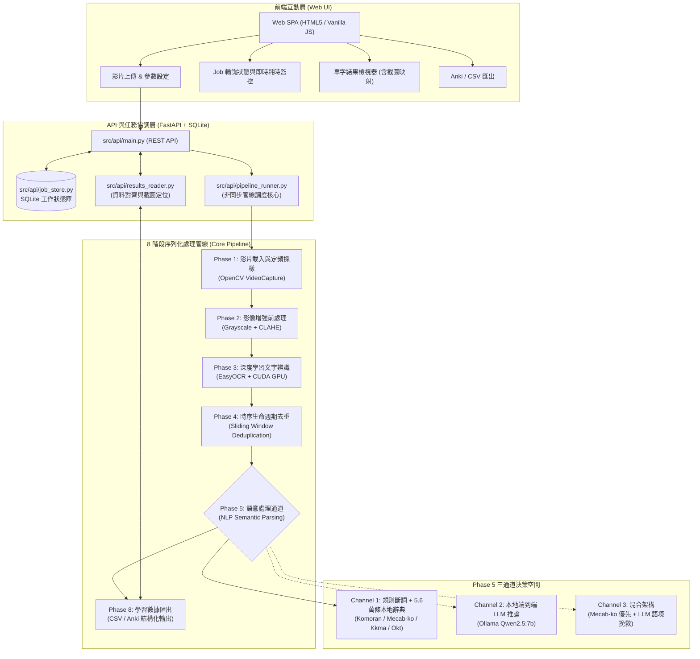
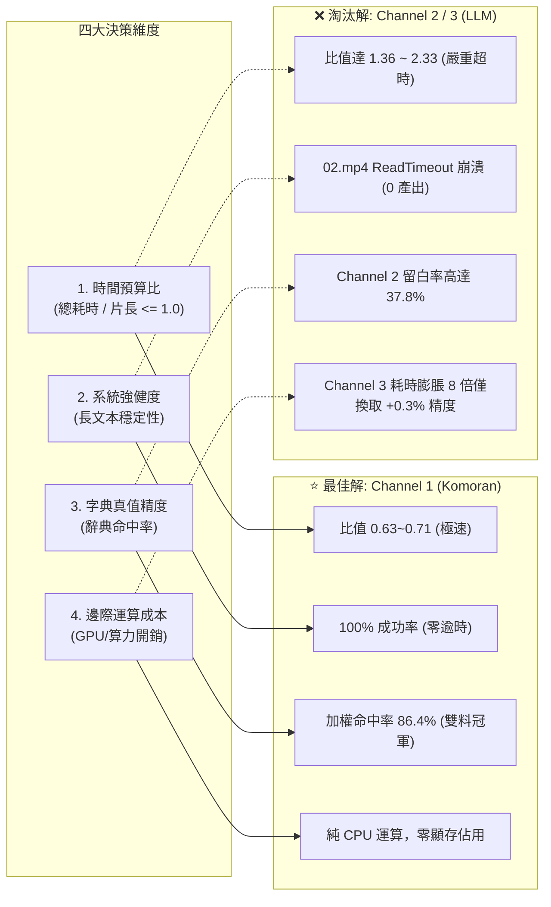

# 專案架構與核心技術深度解析指南
**專案名稱：基於影片 OCR 之韓文學習字幕與字卡擷取系統 (Korean Video Subtitle OCR & Lexicon Pipeline)**

> **目標讀者**：具備 Python 軟體工程、電腦視覺/光學字元辨識 (OCR) 與大型語言模型 (LLM) 基礎認知之開發者或研究人員。  
> **專案核心任務**：輸入任意未標註的韓文教學/生活影片，全自動擷取畫面字幕、去除時序重複、進行多通道自然語言語意解析與字典對齊，最終輸出可直接匯入 Anki 的高質量單字學習卡片與統計報表。

---

## 1. 系統全域架構導覽 (System Overview)

本專案本質為一個**非同步流式管線 (Asynchronous Streaming Pipeline)**，由 FastAPI 作為後端協調核心，前端透過 REST API 與輪詢機制進行互動，後台將長時運算解耦為 8 個嚴格的處理階段（Phase 1 至 Phase 8）。



---

## 2. 核心模組職責與分層架構 (Codebase Structure)

透過 `codebase-memory-mcp` 對本專案 830 個節點與 2,475 條依賴關係進行靜態拓撲分析，系統核心劃分為以下層次：

```
Graduation-Project/
├── config/
│   └── settings.py          # 全域常數設定（取樣率、OCR閥值、去重容錯門檻、API路徑）
├── src/
│   ├── api/                 # 系統控制層 (REST API & Orchestration)
│   │   ├── main.py          # FastAPI 應用工廠與路由端點
│   │   ├── pipeline_runner.py # 核心任務調度器（依序執行 P1~P8 並記錄耗時）
│   │   ├── job_store.py     # SQLite 狀態持久化（支援長達數十分鐘任務之狀態追蹤）
│   │   ├── results_reader.py# 讀取 CSV/報表，進行影格時間戳記截圖映射
│   │   └── environment_check.py # 系統相容性檢查（CUDA、JVM、Ollama、辭典庫）
│   ├── video/               # Phase 1：影片讀取與影格取樣
│   │   ├── loader.py        # 封裝 OpenCV，提取影片中繼資料（FPS、解析度、總影格）
│   │   └── sampler.py       # 定頻取樣演算法，輸出影格至 frames/ 並產生 manifest.csv
│   ├── preprocessing/       # Phase 2：影像強化
│   │   └── pipeline.py      # 灰階轉換 + CLAHE (對比度限制自適應直方圖均衡化)
│   ├── ocr/                 # Phase 3：文字辨識
│   │   ├── recognizer.py    # EasyOCR (PyTorch) 批次辨識封裝，提取文字、BBox 與信心值
│   │   └── gpu_check.py     # 強制 CUDA 硬體檢驗，杜絕 CPU 慢速運算
│   ├── dedup/               # Phase 4：時序降噪
│   │   └── deduplicator.py  # 基於滑動時間窗與狀態機的多字詞生命週期去重演算法
│   ├── nlp/                 # Phase 5：自然語言語意解析
│   │   ├── text_cleaner.py  # Unicode Regex 韓文字元過濾
│   │   ├── tokenizer.py     # 統一抽象介面，封裝 KoNLPy (Komoran/Kkma/Okt) 與 python-mecab-ko
│   │   ├── dictionary.py    # 高性能 SQLite 索引庫，檢索國立國語院韓中辭典
│   │   ├── llm_client.py    # 本地 Ollama REST API 客戶端
│   │   ├── llm_annotator.py # Channel 2 提示詞建構與 JSON 結構化解析
│   │   ├── llm_fallback.py  # Channel 3 生詞語境推測與回退處理器
│   │   └── stats.py         # 統一 RunReport 執行效能與字典命中率度量器
│   ├── export/              # Phase 8：檔案產出
│   │   └── csv_exporter.py  # 輸出標準化學習紀錄與 Anki 匯入用 CSV
│   └── schemas.py           # 全系統 Pydantic v2 資料契約 (OCRResult, DedupedSubtitle 等)
├── frontend/                # 輕量級單頁應用 (SPA)，純原生 HTML/CSS/JS 實現
├── scripts/                 # 獨立測試與驗收腳本
└── tests/                   # 完整回歸測試套件（138+ 項單元測試）
```

---

## 3. 關鍵技術決策與演進 (Engineering & Research Insights)

對於具備 OCR 與 LLM 背景的開發者，本專案在實作過程中有數項值得深入理解的重要架構決策：

### 3.1 影像前處理：為何預設全畫面且關閉 Denoise？
* **CLAHE vs 二值化**：傳統影像處理常使用二值化（Otsu/Adaptive Thresholding），但現代 OCR（如 EasyOCR 所使用的 CRAFT 文字偵測 + CRNN 辨識骨幹）本質為深度卷積神經網路。過度二值化會破壞韓文字母筆畫邊緣的次像素資訊；改用「灰階 + CLAHE（對比度強化）」能有效應對 YouTube 影片多樣的背景與字體顏色。
* **Denoise A/B 測試結果**：
  * 開啟去雜訊（`fastNlMeansDenoising`）後，前處理耗時暴增 **10.36 倍**（11.85s $\to$ 122.82s），使整個管線處理時間多花 **31.2%**。
  * 但 OCR 平均信心分數僅從 0.853 微幅上升至 0.870（**僅提升 2.0%**，遠低於預期門檻 15%），且偵測字數反而減少。
  * **決策**：預設全面**關閉 Denoise**。

### 3.2 時序去重：從「逐影比對」演進為「滑動時間窗生命週期管理」
* **舊版問題（交錯覆蓋）**：教學影片常有多個單字（如菜單或單字表）同時並存。若單一影格回傳 `[字A, 字B, 字C]`，舊版單一暫存器機制在處理 `字B` 時會強制結案 `字A`；下幀再次見到 `字A` 時又誤判為新字，導致停留 10 秒的字卡被切成 **43 筆長度為 0 秒的碎片字卡**。
* **新版解法（分散式狀態表 + 滑動時間窗）**：
  維護 `Dict[str, _OpenGroup]` 狀態字典，以文字字串為鍵獨立追蹤生命週期。同字出現間隔 $\Delta t \le 1.5\text{s}$ 視為連續顯示；若因 OCR 暫態漏檢 1 幀亦可平滑吸收。
* **量化成效**：
  * 去重壓縮率由 **4.9% 提升至 91.2%**（資料降噪收斂 10.8 倍）。
  * 0 秒碎片佔比由 **99.2% 劇降至 16.4%**。
  * 跨影格聚合率由 **0.8% 攀升至 83.6%**。

### 3.3 Phase 5 語意處理：為何 Channel 1 (Komoran) 擊敗了大型語言模型 (LLM)？

在專案設計初期，Channel 2 (純 LLM) 與 Channel 3 (混合 Fallback) 曾被視為最具前瞻性的解法，但經過使用者本機（RTX 4060 GPU、Ollama Qwen2.5:7b）真實測試後，基於客觀數據決定全面淘汰 LLM 作為預設管線：



* **Channel 2 淘汰主因**：在 18.7 分鐘長影片中耗時達 43.5 分鐘，嚴重違反「快於影片播放時間」的系統約束；長序列並發推論引發 Ollama `ReadTimeout`，造成整部影片 0 筆產出；且有高達 37.8% 翻譯留白。
* **Channel 3 淘汰主因**：生詞多為 OCR 辨識殘缺字符，LLM 上下文挽救成功率僅 **1.1% ~ 3.1%**。為了這不到 **+0.5%** 的邊際增益，通道耗時膨脹 **7 至 8 倍**，得不償失。
* **Channel 1 (Komoran) 勝出主因**：加權字典命中率達 **86.4%**（大幅超越 Okt 的 76.1% 與 Mecab-ko 的 81.7%），斷詞與 5.6 萬詞庫比對僅需 10~40 秒，且不與 EasyOCR 爭搶 GPU 顯存，杜絕 CUDA OOM。

---

## 4. API 介面契約與資料流 (API Contracts)

系統核心入口為 `src/api/main.py`，提供符合 RESTful 規範之介面：

| 方法 | 路徑 | 功能說明 | 核心參數 / 回傳 |
|---|---|---|---|
| `POST` | `/api/upload` | 上傳影片並在背景啟動管線 | `file`: 影片檔；`include_channel2`: 布林值；回傳 `job_id` |
| `GET` | `/api/jobs/{job_id}/status` | 查詢處理進度與各階段耗時 | 回傳 `status` (queued/running/done/failed)、各階段 `elapsed_sec` |
| `GET` | `/api/jobs/{job_id}/results` | 取得單字解析結果列表 | `?channel=channel1_komoran`；回傳單字、詞性、例句、時間戳記 |
| `GET` | `/api/jobs/{job_id}/frame` | 取得指定時間戳記之原始截圖 | `?timestamp=15.2`；直接回傳 JPEG 二進位影像供前端渲染 |
| `POST` | `/api/jobs/{job_id}/export` | 匯出結構化學習資料 | `?format=csv&channel=channel1_komoran`；下載 CSV 檔案 |
| `GET` | `/api/environment` | 開發與執行環境自我診斷 | 檢查 Python、CUDA/GPU、JVM、KoNLPy 引擎狀態 |

---

## 5. 快速上手與本地驗證 (Developer Guide)

### 5.1 環境需求
* **作業系統**：Windows 11 / WSL2 (Ubuntu 22.04+)
* **硬體需求**：NVIDIA 獨立顯卡（建議 VRAM $\ge$ 6GB，用於 EasyOCR 與 CUDA 加速）
* **軟體依賴**：
  * Python 3.10+
  * Java JDK 11+（供 KoNLPy 之 Komoran/Kkma 運作，需配置 `JAVA_HOME`）
  * （選用）Ollama + `qwen2.5:7b`（僅於啟用 Channel 2/3 時需要）

### 5.2 啟動步驟
```bash
# 1. 建立並啟動虛擬環境
python -m venv .venv
.\.venv\Scripts\Activate.ps1  # Windows PowerShell

# 2. 安裝核心相依套件
pip install -r requirements.txt

# 3. 執行單元與回歸測試 (138 項全過驗證)
pytest tests/ -q

# 4. 啟動後端服務與前端介面
uvicorn src.api.main:app --host 127.0.0.1 --port 8000
```
瀏覽器造訪 `http://127.0.0.1:8000` 即可開啟完整 Web 使用者介面。
